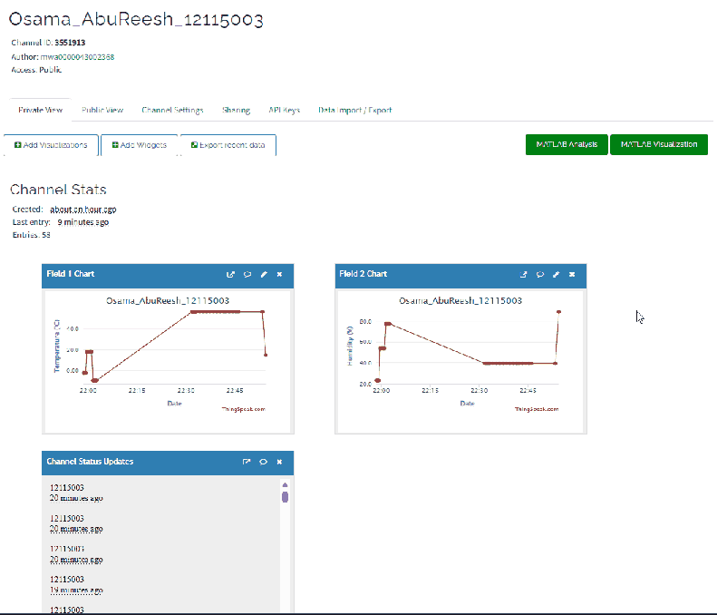
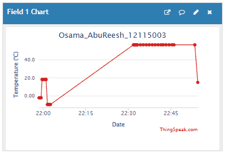
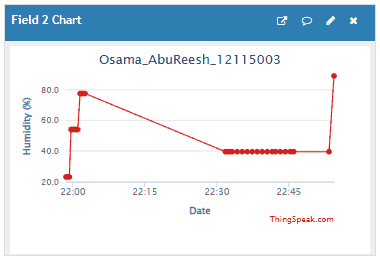
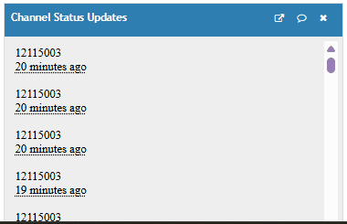

# ESP32 → ThingSpeak

**Name:** Osama Abu Reesh
**University ID:** 12115003

## Project Description
An ESP32 reads temperature and humidity from a DHT22 sensor and sends the readings to a public ThingSpeak channel every 20 seconds over Wi-Fi. The project was built and tested in the Wokwi simulator.

How it works:
1. The ESP32 connects to Wi-Fi (`Wokwi-GUEST`).
2. It reads temperature (°C) and humidity (%) from the DHT22.
3. It sends them to ThingSpeak with an HTTP GET request:
   - `field1` = Temperature
   - `field2` = Humidity
   - `status` = University ID (12115003)
4. It prints the ID, readings and HTTP response code to the Serial Monitor, then waits 20 seconds.

## Links
- **ThingSpeak public channel:** https://thingspeak.com/channels/3551913
- **Wokwi project:** https://wokwi.com/projects/478979793229571073

## Wiring
| DHT22 | ESP32 |
|-------|-------|
| VCC   | 3V3   |
| SDA (DATA) | GPIO 15 |
| GND   | GND   |

The full Wokwi schematic is in `diagram.json`.

## Files
| File | Description |
|------|-------------|
| `sketch.ino` | ESP32 source code |
| `diagram.json` | Wokwi wiring diagram |
| `libraries.txt` | Required library (DHT sensor library) |
| `screenshots/` | ThingSpeak screenshots |

> Note: The real Write API Key was replaced with `YOUR_WRITE_API_KEY` for security.

## Screenshots

### ThingSpeak Channel Page

### Temperature Graph

### Humidity Graph

### University ID in Status Updates

